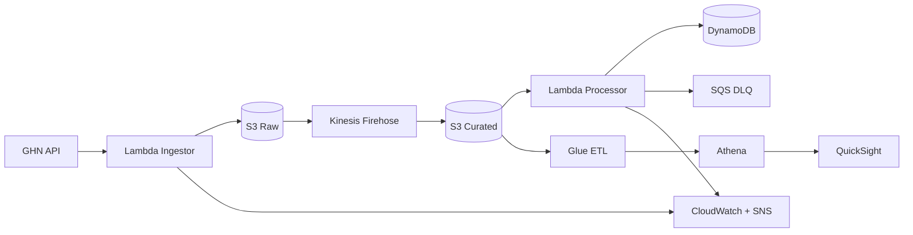

# GHN Logistics Analytics Platform

Data pipeline that ingests order, shipping-status and master data from the
GHN API and turns it into operational dashboards.

## Architecture



Each layer has one source of truth: S3 raw is the durable backup, S3 curated
is the analytics source of truth, DynamoDB is the real-time lookup, and SQS
DLQ holds everything that failed.

## Repository layout

| Path | Purpose |
|---|---|
| `cdk/` | AWS CDK app. One stack per logical boundary, reusable constructs in `cdk/constructs/`. |
| `src/lambda/` | Runtime code for the Ingestor and Processor, each with its own tests. |
| `src/glue/` | ETL jobs, schemas and data-quality rules. |
| `tests/` | Integration and end-to-end tests that need a running stack. |
| `scripts/` | Operational tooling: backfill, DLQ replay, pre-deploy checks. |
| `quicksight/` | Dashboard assets, exported and deployed as code. |
| `docs/` | Architecture, runbook and ADRs. |

## Getting started

```bash
make venv
make install
make check          # lint + typecheck + unit tests
```

## Deploying

```bash
aws configure          # once
make deploy           # cdk deploy --all
```

Deploy order is enforced by stack dependencies: base → {ingestion, streaming,
processing, analytics, monitoring}.

The GHN API token is never in this repo. Seed it into Secrets Manager
before the first ingest run:

```bash
aws secretsmanager put-secret-value \
  --secret-id ghn-analytics-dev-ingestion/ghn-api \
  --secret-string '{"token":"<your-token>"}'
```

## Daily operations

```bash
make validate-env                # pre-deploy sanity checks
python scripts/replay_dlq.py <dlq-url> --dry-run
python scripts/backfill.py --days 7 --dry-run
```

Alerts land on the SNS topic exported by the monitoring stack. See
`docs/runbook.md` for what to do when one fires.

## Conventions

Commits follow [Conventional Commits](https://www.conventionalcommits.org/).
`commitlint` rejects anything else at commit time.

```
feat(ingestor): add ward master data endpoint
fix(processor): treat naive timestamps as UTC
docs(runbook): add kafka lag triage steps
```

Branch names: `feat/<ticket>-<slug>`, `fix/<ticket>-<slug>`,
`chore/<ticket>-<slug>`. `main` is protected and deploys automatically.

## Documentation

- `docs/architecture.md` — data flow and design decisions
- `docs/runbook.md` — operations and incident response
- `docs/adr/` — architecture decision records
