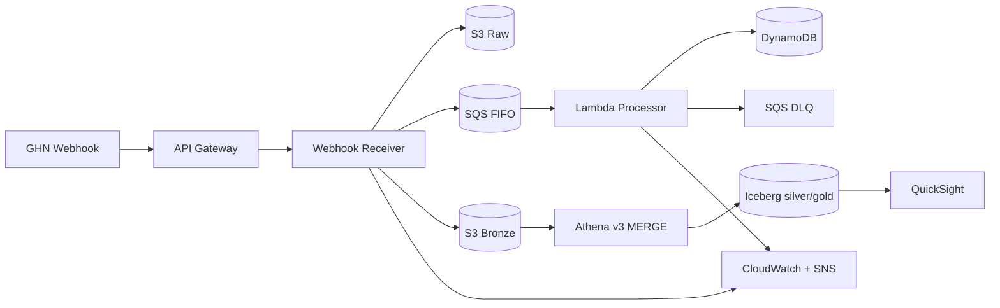

# GHN Logistics Analytics Platform

Data pipeline that ingests order, shipping-status and master data from the
GHN API and turns it into operational dashboards.

## Architecture



Each layer has one source of truth: S3 raw is the durable backup, S3 bronze is
the analytics input, the Iceberg silver/gold tables are the analytical source
of truth, DynamoDB is the real-time lookup, and SQS DLQ holds everything that
failed.

## Repository layout

| Path | Purpose |
|---|---|
| `cdk/` | AWS CDK app. One stack per logical boundary, reusable constructs in `cdk/constructs/`. |
| `src/lambda/` | Runtime code for the Ingestor and Processor, each with its own tests. |
| `src/glue/` | ETL jobs, schemas and data-quality rules. |
| `tests/` | Integration and end-to-end tests that need a running stack. |
| `scripts/` | Operational tooling: backfill, DLQ replay, pre-deploy checks. |
| `quicksight/` | Dashboard assets, exported and deployed as code. |
| `docs/` | Architecture, runbook and ADRs. |

## Getting started

```bash
python3 -m venv .venv
source .venv/bin/activate
pip install -r requirements-dev.txt

ruff check src cdk tests scripts   # lint
mypy src cdk tests                 # typecheck
pytest                              # unit tests
```

### Trying it without deploying anything

You can exercise the pipeline logic on a laptop, before any AWS resource
exists. Two ways, depending on what you want to check:

**Check the code logic (no token, no network, no dependencies):**

```bash
python3 run_tests.py -v
```

This runs the whole unit suite - validation, transformation, idempotent
DynamoDB writes, API retry behaviour, data-quality rules - using only
the Python standard library. Useful on a fresh machine or in CI before
the toolchain is installed.

**Check that your GHN token works and see the real payloads:**

```bash
cp .env.example .env      # then paste your token into GHN_API_TOKEN
python3 scripts/test_api.py        # read-only probe of every endpoint
```

`scripts/test_api.py` never writes to S3 or DynamoDB. It just calls
the API and prints the records, so you can confirm the token, the field
names and the record shapes before anything is deployed.

For a GHN staging order and a real callback through an HTTPS tunnel into
LocalStack, follow [the local webhook guide](docs/GHN_STAGING_LOCAL_WEBHOOK.md).

### Local configuration

To run the Processor as a Lambda triggered automatically by LocalStack SQS:

```bash
docker compose up -d
python scripts/init_local_env.py
python scripts/deploy_processor_local.py
python scripts/test_processor_lambda_local.py
```

The Lambda writes Orders to DynamoDB and archives events to MinIO Bronze
(JSON objects and an Iceberg table committed through Trino). It does not write
to curated. `deploy_processor_local.py` automatically detects your Docker/host
architecture (`x86_64` or `arm64`, overrideable with `LOCAL_LAMBDA_ARCH`) and
pulls the matching Python 3.12 Lambda runtime image, so it works on Windows,
macOS (Intel/Apple Silicon), and Linux without manual changes. Stop
`scripts/run_processor_local.py` while the Lambda mapping is enabled. Run
deployment again after changing Processor code. The verification script leaves
one uniquely named test order and its Bronze event for inspection. Failed
messages retry through SQS and move to the processor FIFO DLQ after five
receives. LocalStack 3.8 Community resources are ephemeral across container
recreation, so rerun initialization and deployment afterwards.

`.env` holds local-only settings and is gitignored. The Ingestor reads
its token from `GHN_API_TOKEN` when `GHN_SECRET_ARN` is unset, and from
AWS Secrets Manager when it is set - the same code path serves both, so
what you test locally is what runs in AWS.

```bash
cp .env.example .env
```

### Chạy demo local và kiểm tra dữ liệu

Luồng local dùng LocalStack cho S3, DynamoDB, SQS và Lambda; MinIO lưu Bronze/Iceberg; Trino dùng để truy vấn bảng Iceberg. Từ PowerShell tại thư mục gốc repository:

```powershell
Copy-Item .env.example .env -ErrorAction SilentlyContinue
docker compose up -d
python -m pip install -r requirements-dev.txt
python scripts/init_local_env.py
python scripts/deploy_processor_local.py
```

Kiểm tra dịch vụ:

```powershell
docker compose ps
Invoke-RestMethod http://localhost:4566/_localstack/health
Invoke-RestMethod http://localhost:8080/v1/info
Invoke-WebRequest http://localhost:9000/minio/health/live
```

Cách tạo đơn demo nhanh nhất không gọi GHN và không cần token là gửi webhook giả trực tiếp vào handler:

```powershell
python scripts/demo_webhook.py --status delivering
python scripts/inspect_local_data.py
python scripts/inspect_local_data.py --order-code <MA_DON_MAU>
```

Để tạo đơn thật trên GHN staging, điền `GHN_API_TOKEN`, `GHN_SHOP_ID` và giữ `GHN_BASE_URL=https://dev-online-gateway.ghn.vn` trong `.env`:

```powershell
python scripts/create_demo_order.py --dry-run --client-order-code STAGING-DEMO-001
python scripts/create_demo_order.py --client-order-code STAGING-DEMO-001
```

Kết quả `order_code` được lưu vào `.local_staging_orders.jsonl`. Kiểm tra chi tiết đơn staging:

```powershell
$env:GHN_ORDER_CODES = "<MA_DON_GHN>"
python scripts/test_api.py --endpoint orders --limit 1
```

Để nhận callback staging qua tunnel, chạy server local ở một terminal và forward cổng 8000 bằng ngrok hoặc Cloudflare Tunnel:

```powershell
python scripts/serve_webhook_local.py
Invoke-RestMethod http://127.0.0.1:8000/health
ngrok http 8000
```

Khai báo URL HTTPS của tunnel trong GHN Developer Portal cùng custom header `X-GHN-Webhook-Token` có giá trị giống `GHN_CALLBACK_SHARED_TOKEN`.

### Kiểm tra từng nơi lưu dữ liệu

Script tổng hợp đọc S3 Raw, hai bảng DynamoDB và SQS FIFO:

```powershell
python scripts/inspect_local_data.py --order-code <MA_DON>
```

Script này không xóa message SQS, nhưng việc nhận message sẽ tăng receive count.

Kiểm tra S3 Raw trực tiếp bằng AWS CLI:

```powershell
$awsLocal = @("--endpoint-url", "http://localhost:4566", "--region", "ap-southeast-1")
aws s3api list-objects-v2 --bucket ghn-analytics-local-raw @awsLocal
aws s3 cp s3://ghn-analytics-local-raw/ ./tmp-raw --recursive @awsLocal
```

Kiểm tra DynamoDB:

```powershell
aws dynamodb list-tables @awsLocal
aws dynamodb scan --table-name ghn-analytics-local-watchlist @awsLocal
aws dynamodb scan --table-name ghn-analytics-local-orders @awsLocal
```

Kiểm tra SQS FIFO và DLQ:

```powershell
aws sqs list-queues --queue-name-prefix ghn-analytics-local @awsLocal
aws sqs get-queue-url --queue-name ghn-analytics-local-webhook.fifo @awsLocal
```

Kiểm tra Bronze trong MinIO bằng AWS CLI:

```powershell
$awsMinio = @("--endpoint-url", "http://localhost:9000", "--region", "ap-southeast-1")
$env:AWS_ACCESS_KEY_ID = "admin"
$env:AWS_SECRET_ACCESS_KEY = "password123"
aws s3api list-buckets @awsMinio
aws s3api list-objects-v2 --bucket ghn-analytics-bronze @awsMinio
aws s3 cp s3://ghn-analytics-bronze/ ./tmp-bronze --recursive @awsMinio
```

MinIO Console mở tại <http://localhost:9001>, đăng nhập bằng `admin` và `password123`. Trino mở tại <http://localhost:8080>. Truy vấn thử bảng Iceberg qua Trino:

```powershell
Invoke-RestMethod -Method Post -Uri http://localhost:8080/v1/statement -Headers @{ "X-Trino-User" = "local" } -ContentType "text/plain" -Body "SHOW TABLES FROM iceberg.bronze"
Invoke-RestMethod -Method Post -Uri http://localhost:8080/v1/statement -Headers @{ "X-Trino-User" = "local" } -ContentType "text/plain" -Body "SELECT * FROM iceberg.bronze.ghn_events LIMIT 20"
```

Sau khi sửa code Processor, chạy lại `python scripts/deploy_processor_local.py`. Khi dừng môi trường local:

```powershell
docker compose down
```

## Deploying

```bash
aws configure          # once
cdk deploy --all --app "python cdk/app.py"
```

Deploy order is enforced by stack dependencies: base → {ingestion, streaming,
processing, analytics, monitoring}.

The GHN API token is never in this repo. Seed it into Secrets Manager
before the first ingest run:

```bash
aws secretsmanager put-secret-value \
  --secret-id ghn-analytics-dev-ingestion/ghn-api \
  --secret-string '{"token":"<your-token>"}'
```

## Daily operations

```bash
python scripts/validate_env.py             # pre-deploy sanity checks
python scripts/replay_dlq.py <dlq-url> --dry-run
python scripts/backfill.py --days 7 --dry-run
```

Alerts land on the SNS topic exported by the monitoring stack. See
`docs/runbook.md` for what to do when one fires.

## Conventions

Commits follow [Conventional Commits](https://www.conventionalcommits.org/).
`commitlint` rejects anything else at commit time.

```
feat(ingestor): add ward master data endpoint
fix(processor): treat naive timestamps as UTC
docs(runbook): add kafka lag triage steps
```

Branch names: `feat/<ticket>-<slug>`, `fix/<ticket>-<slug>`,
`chore/<ticket>-<slug>`. `main` is protected and deploys automatically.

## Documentation

- `docs/architecture.md` — data flow and design decisions
- `docs/runbook.md` — operations and incident response
- `docs/adr/` — architecture decision records
