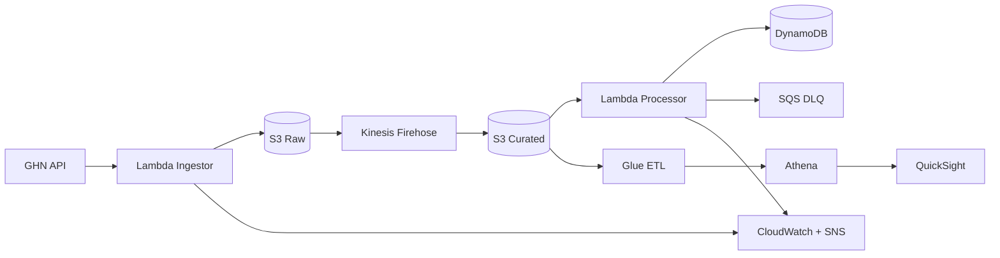

# GHN Logistics Analytics Platform

Data pipeline that ingests order, shipping-status and master data from the
GHN API and turns it into operational dashboards.

## Architecture



Each layer has one source of truth: S3 raw is the durable backup, S3 curated
is the analytics source of truth, DynamoDB is the real-time lookup, and SQS
DLQ holds everything that failed.

## Repository layout

| Path | Purpose |
|---|---|
| `cdk/` | AWS CDK app. One stack per logical boundary, reusable constructs in `cdk/constructs/`. |
| `src/lambda/` | Runtime code for the Ingestor and Processor, each with its own tests. |
| `src/glue/` | ETL jobs, schemas and data-quality rules. |
| `tests/` | Integration and end-to-end tests that need a running stack. |
| `scripts/` | Operational tooling: backfill, DLQ replay, pre-deploy checks. |
| `quicksight/` | Dashboard assets, exported and deployed as code. |
| `docs/` | Architecture, runbook and ADRs. |

## Getting started

```bash
python3 -m venv .venv
source .venv/bin/activate
pip install -r requirements-dev.txt

ruff check src cdk tests scripts   # lint
mypy src cdk tests                 # typecheck
pytest                              # unit tests
```

### Trying it without deploying anything

You can exercise the pipeline logic on a laptop, before any AWS resource
exists. Two ways, depending on what you want to check:

**Check the code logic (no token, no network, no dependencies):**

```bash
python3 run_tests.py -v
```

This runs the whole unit suite - validation, transformation, idempotent
DynamoDB writes, API retry behaviour, data-quality rules - using only
the Python standard library. Useful on a fresh machine or in CI before
the toolchain is installed.

**Check that your GHN token works and see the real payloads:**

```bash
cp .env.example .env      # then paste your token into GHN_API_TOKEN
python3 scripts/test_api.py        # read-only probe of every endpoint
```

`scripts/test_api.py` never writes to S3, Kinesis or DynamoDB. It just calls
the API and prints the records, so you can confirm the token, the field
names and the record shapes before anything is deployed.

### Local configuration

`.env` holds local-only settings and is gitignored. The Ingestor reads
its token from `GHN_API_TOKEN` when `GHN_SECRET_ARN` is unset, and from
AWS Secrets Manager when it is set - the same code path serves both, so
what you test locally is what runs in AWS.

```bash
cp .env.example .env
```

## Deploying

```bash
aws configure          # once
cdk deploy --all --app "python cdk/app.py"
```

Deploy order is enforced by stack dependencies: base → {ingestion, streaming,
processing, analytics, monitoring}.

The GHN API token is never in this repo. Seed it into Secrets Manager
before the first ingest run:

```bash
aws secretsmanager put-secret-value \
  --secret-id ghn-analytics-dev-ingestion/ghn-api \
  --secret-string '{"token":"<your-token>"}'
```

## Daily operations

```bash
python scripts/validate_env.py             # pre-deploy sanity checks
python scripts/replay_dlq.py <dlq-url> --dry-run
python scripts/backfill.py --days 7 --dry-run
```

Alerts land on the SNS topic exported by the monitoring stack. See
`docs/runbook.md` for what to do when one fires.

## Conventions

Commits follow [Conventional Commits](https://www.conventionalcommits.org/).
`commitlint` rejects anything else at commit time.

```
feat(ingestor): add ward master data endpoint
fix(processor): treat naive timestamps as UTC
docs(runbook): add kafka lag triage steps
```

Branch names: `feat/<ticket>-<slug>`, `fix/<ticket>-<slug>`,
`chore/<ticket>-<slug>`. `main` is protected and deploys automatically.

## Documentation

- `docs/architecture.md` — data flow and design decisions
- `docs/runbook.md` — operations and incident response
- `docs/adr/` — architecture decision records
