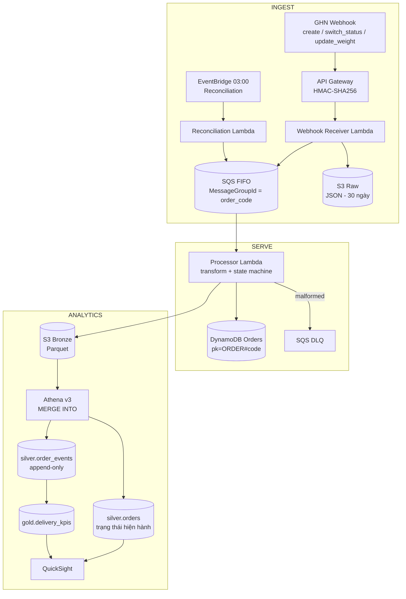

# Đề xuất dự án kỹ thuật: Nền tảng dữ liệu Logistics cho GHN

**Người đề xuất:** Nguyễn Đình Tấn Lộc (Data Engineering)
**Vai trò hệ thống:** Nền tảng dữ liệu phía doanh nghiệp / đối tác tích hợp (Merchant Data Platform), kết nối với dịch vụ vận chuyển Giao Hàng Nhanh
**Trạng thái:** Kiến trúc đã chốt, sẵn sàng triển khai

---

## 1. Tóm tắt điều hành

Hệ thống thu thập dữ liệu vận đơn từ GHN và phục vụ hai nhu cầu khác nhau bằng hai đường đi riêng:

| | Đường phục vụ vận hành | Đường phục vụ phân tích |
|---|---|---|
| **Nguồn chính** | Webhook (GHN đẩy sang) | Webhook + đối soát bù giờ hằng ngày |
| **Lưu trữ phục vụ** | DynamoDB (tra cứu 1 đơn) | Apache Iceberg trên S3 (bảng silver/gold) |
| **Engine** | Lambda | Athena v3 serverless (`MERGE INTO`) |
| **Độ tươi dữ liệu** | < 5 giây | <= 60 phút |
| **Người dùng** | CSKH, vận hành | BI / Phân tích |

Ba quyết định cốt lõi:

1. **Webhook-first, polling chỉ để đối soát.** Polling toàn bộ đơn mở mỗi 5 phút sẽ tạo 17-26 triệu call/ngày (~200-300 call/giây) và chắc chắn bị GHN rate-limit. Polling chỉ chạy 1 lần/ngày lúc 03:00 để bù các webhook bị rớt.
2. **Iceberg + Athena thay vì Spark/Glue.** Đơn hàng đổi trạng thái 5-7 lần trong vòng đời, nên cần upsert theo dòng. Athena `MERGE INTO` serverless làm việc đó với chi phí dưới $2/tháng, thay vì bật Glue Spark hằng giờ ($30-60/tháng).
3. **Không ghi đè trạng thái đã kết thúc.** Đơn đã `delivered` không bao giờ bị một event cũ ghi đè, kể cả khi event đó đến muộn.

Chi phí ước tính toàn hệ thống: **~$40/tháng**, nằm trong khoản credit $200 cho 3 tháng.

---

## 2. Bối cảnh và vấn đề cần giải quyết

GHN là đối tác vận chuyển của doanh nghiệp. Dữ liệu vận đơn là chứng từ hợp đồng dịch vụ và chứng từ hạch toán thuế - nó vừa cần cho BI, vừa phải bảo vệ theo Luật Bảo vệ dữ liệu cá nhân.

Ba đặc điểm của dữ liệu này quyết định toàn bộ thiết kế:

**Quy mô.** 30.000 đơn/ngày, 60.000-90.000 đơn đang mở tại mọi thời điểm.

**Biến động trạng thái.** Mỗi đơn đổi trạng thái 5-7 lần (`ready_to_pick` -> `picking` -> `storing` -> `delivering` -> `delivered`). Dữ liệu vì thế là *mutable*, không phải append-only thuần.

**API không cho xem danh sách.** GHN không có endpoint list-orders; phải biết `order_code` mới gọi được chi tiết đơn. Danh sách mã đơn cần theo dõi là **state của pipeline**, không phải config.

Nếu giải quyết naively - poll mọi đơn mỗi 5 phút, lưu Parquet thuần trên S3 - sẽ đụng ba giới hạn cùng lúc: chi phí API vượt ngân sách, tỷ lệ mất event không đo được, và truy vấn BI chậm vì dữ liệu trùng lặp phải được lọc thủ công.

---

## 3. Mục tiêu và phạm vi

**Mục tiêu**

- Thu thập 100% sự kiện trạng thái của mỗi đơn, kể cả khi webhook bị rớt.
- Tra cứu trạng thái 1 đơn trong < 15 ms.
- Báo cáo KPI vận hành cập nhật <= 60 phút.
- Tuân thủ Luật 91/2025/QH15: BI không nhìn thấy PII thô.

**Ngoài phạm vi**

- Không quản lý danh mục sản phẩm, tồn kho, đối soát tiền mặt.
- Không thay thế hệ thống OMS của doanh nghiệp.
- Không cam kết SLA với bên thứ ba ngoài GHN.

---

## 4. Kiến trúc tổng thể



### 4.1. Tầng và nguồn sự thật

Mỗi tầng có đúng một nguồn sự thật. Không tầng nào đọc từ tầng không phải của nó.

| Tầng | Lưu ở đâu | Là nguồn sự thật cho | Giữ lại |
|---|---|---|---|
| Raw | S3 `raw/` | Sao lưu mọi response API gốc | 30 ngày |
| Bronze | S3 `bronze/` | Dữ liệu đầu vào cho lớp phân tích | 90 ngày |
| Silver | Iceberg `orders` / `order_events` | Trạng thái hiện hành + nhật ký sự kiện | Không giới hạn |
| Gold | Iceberg `delivery_kpis` | KPI vận hành | Không giới hạn |
| Serving | DynamoDB | Tra cứu điểm 1 đơn | Không giới hạn |
| Lỗi | SQS DLQ | Mọi record thất bại, chờ xử lý | 14 ngày |

**Nguyên tắc không mất dữ liệu:** record nào không validate được hoặc không ghi được thì vào DLQ kèm lý do, và `scripts/replay_dlq.py` đưa lại được. Không có đường nào "đếm xong rồi vứt".

### 4.2. Vì sao cần tầng Raw

Webhook Receiver ghi Raw **trước**, rồi mới đẩy vào SQS. Nếu SQS nhận message rồi Lambda chết, hoặc Firehose bị throttle, hoặc schema đổi làm parse hỏng - payload gốc vẫn nằm trên S3 và pipeline replay được từ đó. Bỏ tầng Raw thì mọi lỗi tạm thời đều thành mất dữ liệu.

---

## 5. Thiết kế chi tiết

### 5.1. Nguồn dữ liệu: Webhook-first, polling để đối soát

**Luồng chính.** GHN gọi webhook (`create`, `switch_status`, `update_weight`) tới API Gateway. Receiver kiểm tra chữ ký HMAC-SHA256, ghi Raw, rồi đẩy vào SQS FIFO với `MessageGroupId = order_code` - đảm bảo các sự kiện của cùng một đơn được xử lý đúng thứ tự.

**Luồng đối soát.** Mỗi đêm 03:00, Reconciliation Lambda đọc danh sách đơn chưa hoàn tất từ DynamoDB watchlist, poll lại trạng thái hiện tại từ GHN và đẩy vào FIFO nếu có khác biệt. Đây là lưới an toàn cho trường hợp mạng giữa GHN và AWS đứt.

**Vì sao không poll toàn bộ.** 30.000 đơn/ngày x 60.000-90.000 đơn mở x 288 lần/ngày ~ 17-26 triệu call/ngày. Nghĩa là bị 429 chắc chắn, và chi phí tính bằng nghìn USD/tháng.

**Vì sao cần mảng `log`.** Chi tiết vận đơn của GHN trả về mảng `log` ghi lại toàn bộ các bước chuyển trạng thái kèm mốc thời gian. Bung mảng này ra bảng nhật ký sự kiện giúp giữ được 100% sự kiện trung gian, kể cả khi mạng gián đoạn - vì lần poll sau vẫn thấy lịch sử đầy đủ.

### 5.2. Máy trạng thái hai cấp

Vấn đề cốt lõi: event đến muộn không được phép phá hỏng trạng thái hiện tại.

```
Cấp 1 - GIAI ĐOẠN LẤY HÀNG
  ready_to_pick -> picking -> picked

Cấp 2 - GIAI ĐOẠN VẬN CHUYỂN
  storing -> sorting -> transporting

Cấp 3 - VÒNG LẶP GIAO LẠI
  delivering --> delivery_fail --> (giao lại lần 2) --> delivering

Cấp 4 - TRẠNG THÁI KẾT THÚC
  delivered · returned · cancelled · lost · damage · scrap · exception
```

**Ba luật so sánh, áp dụng theo thứ tự:**

1. **Trạng thái kết thúc là bất biến.** Đơn đã `delivered` không bị ghi đè bởi bất kỳ trạng thái nào khác, kể cả event đến muộn hơn.
2. **Lượt giao đếm được.** `delivery_attempt = 1 + số lần xuất hiện delivery_fail trước thời điểm event` - tính từ mảng `log`. Lần giao thứ nhất = 1; sau một lần thất bại, lần giao tiếp theo = 2.
3. **Trong cùng lượt giao, so phase.** `phase_rank` đánh số thứ tự trong lượt (giao hàng 40, thất bại 50...). `delivering` không bao giờ ghi đè `delivery_fail` cùng lượt - chống lệch đồng hồ bưu tá. Lượt giao mới có `delivery_attempt` cao hơn nên vẫn ghi đè hợp lệ.

**Định nghĩa thứ tự ưu tiên khi nhiều event cùng batch:**

```
is_terminal > delivery_attempt > phase_rank > updated_at
```

Luật này được áp dụng giống hệt ở ba nơi, để DynamoDB và bảng Iceberg không bất đồng với nhau:

| Nơi | Cơ chế |
|---|---|
| DynamoDB (serving) | Conditional put: `attribute_not_exists(pk)` hoặc bộ điều kiện phân cấp trong `ddb_writer.py` |
| Iceberg `silver.orders` | `ROW_NUMBER()` lọc 1 bản ghi ưu tiên nhất mỗi `order_code`, rồi `MERGE INTO` có điều kiện (`sql/03_merge_orders.sql`) |
| Iceberg `silver.order_events` | `event_id = sha256(order_code || status || updated_at)`, append-only, `WHEN NOT MATCHED` (idempotent) |

**Trạng thái lạ.** Mã trạng thái mới chưa có trong từ điển được gán nhãn `unknown_state` và đưa vào bảng giám sát ngoại lệ - không làm sập pipeline, không đẩy vào DLQ.

### 5.3. Idempotency ở từng bước

| Bước | Khóa | Hành vi khi chạy lại |
|---|---|---|
| Webhook -> SQS FIFO | `MessageDeduplicationId = sha256(code‖status‖updated_at‖weight‖cod)` | FIFO tự chặn trùng trong 5 phút |
| Processor -> DynamoDB | `pk=ORDER#{code}`, `sk={created_date}` + conditional put | Trả `DUPLICATE`, không ghi dòng thứ hai |
| Bronze -> `order_events` | `event_id` | `WHEN NOT MATCHED`, số dòng không đổi |
| Bronze -> `orders` | `ROW_NUMBER()` + `MERGE` có điều kiện | Giữ bản ghi ưu tiên cao nhất |
| Firehose -> curated | Tự nhiên at-least-once | Glue/Athena dedup khi merge |

### 5.4. Quản lý dữ liệu

**Bảng `silver.order_events`** - nhật ký append-only, một dòng cho mỗi lần trạng thái đổi. Nguồn sự thật cho lịch sử và cho việc tính KPI dựa trên cohort.

**Bảng `silver.orders`** - trạng thái hiện hành mỗi đơn, cập nhật bằng merge có điều kiện.

**Bảng `gold.delivery_kpis`** - KPI tổng hợp theo ngày tạo đơn và tuyến vận chuyển.

**Bảo trì.** `OPTIMIZE ... REWRITE DATA USING BIN_PACK` gộp file Parquet nhỏ, `VACUUM` dọn snapshot cũ. Chạy lúc 02:00, tách hoàn toàn khỏi khung giờ chạy `MERGE` để tránh xung đột commit (Iceberg OCC).

---

## 6. Định nghĩa KPI

| KPI | Công thức | Ghi chú |
|---|---|---|
| **First-Attempt Delivery Rate (FADR)** | Số đơn `delivered` với `attempt = 1` / Số đơn đã hoàn tất lượt giao 1 (`delivered` hoặc `delivery_fail`) | Đo chất lượng lần giao đầu |
| **Return Rate** | Số đơn `returned` / Số đơn đã kết thúc (cohort 7-10 ngày trước) | Cohort đủ thời gian để đi hết vòng đời |
| **On-Time Delivery Rate (OTDR)** | Số đơn `delivered_at <= sla_committed_at` / Số đơn `delivered` | Cần trường `sla_committed_at` từ nguồn |
| **Pick-to-Delivery Lead Time** | Trung bình (`delivered_at - picked_at`), bỏ qua NULL | Tính trên cohort đã hoàn tất |

---

## 7. Bảo mật và tuân thủ (Luật 91/2025/QH15)

**Cơ sở pháp lý.** Vận đơn là chứng từ hợp đồng vận tải và chứng từ hạch toán thuế -> thuộc nghĩa vụ lưu trữ bắt buộc 1-5 năm. Quyền yêu cầu xóa của chủ thể dữ liệu chỉ áp dụng với dữ liệu marketing/hồ sơ, không được làm sai lệch chứng từ kế toán.

**Ba lớp bảo vệ:**

1. **Mã hóa at-rest** - S3, DynamoDB, SQS dùng AWS KMS Customer Managed Key, tự xoay khóa hằng năm.
2. **Masking ở tầng BI** - Lake Formation chỉ lọc cột, không sinh chuỗi che mờ. Vì vậy dựng View riêng `ghn_analytics.orders_masked`:
   - `to_phone` -> `090*****89`
   - `to_name` -> `N***`
   - Giữ nguyên giá trị `REDACTED` sau khi thực thi quyền được xóa.
3. **Right to be Forgotten** - khi yêu cầu xóa hợp lệ: cập nhật `to_name`/`to_phone`/`to_address` = `'REDACTED'` trên cả DynamoDB (serving) và `silver.orders` (lakehouse); tầng Raw tự xoá theo lifecycle 30 ngày.

**Phân quyền dự kiến:** nhóm BI chỉ đọc được `orders_masked`; nhóm CSKH đọc được PII giải mã qua DynamoDB có kiểm soát.

---

## 8. Kiểm thử

Bộ kiểm thử tự động hiện có: **69 test case, pass 100%** (`python3 run_tests.py`, không cần mạng). Bao phủ: chuẩn hoá status, tính `delivery_attempt` từ `log`, terminal immunity, out-of-order stale, clock skew, retry loop, idempotent write, backoff khi API lỗi.

**Ma trận chaos test** (môi trường Docker: Trino 435 + MinIO + Iceberg REST + LocalStack):

| Mã | Tình huống | Kỳ vọng |
|---|---|---|
| **TC-01** | Webhook FIFO sequencing | 3 event liên tiếp của 1 đơn -> xử lý đúng thứ tự tuyệt đối |
| **TC-02** | Giao lại lần 2 | `delivering(1)` -> `delivery_fail` -> `delivering(2)` -> `delivered` -> bảng `orders` ghi `delivered (attempt 2)` |
| **TC-03** | Chống out-of-order stale | `delivered` lúc 11:00 rồi `delivering(1)` lúc 11:05 -> `delivered` giữ nguyên |
| **TC-04** | Idempotent event log | Chạy lại cùng batch -> `order_events` không tăng số dòng |
| **TC-05** | Bung mảng `log` lịch sử | Payload có 5 bước trong `log` -> hệ thống bung đủ 5 dòng vào `order_events` |
| **TC-06** | Athena SQL parity | Chạy `MERGE INTO` trực tiếp trên Trino container -> thành công 100% cú pháp |

Bộ dữ liệu mẫu: `scripts/simulate_webhook.py generate` sinh 10.000 đơn, trong đó ~500 đơn lệch đồng hồ và ~666 đơn event đảo thứ tự.

---

## 9. Chi phí

| Dịch vụ | Quy cách & tải | Chi phí/tháng |
|---|---|---|
| API Gateway + Lambda | Receiver (~100k request/tháng) + Processor + Reconciliation | ~$1.20 |
| SQS FIFO | Hàng đợi đệm bảo đảm thứ tự theo đơn | ~$0.40 |
| S3 | 10 GB raw (Glacier) + 20 GB silver/metadata Iceberg | ~$1.20 |
| DynamoDB | On-demand, ~1 triệu write + 2 triệu read/tháng | ~$2.50 |
| Athena v3 serverless | `MERGE INTO` 24 lần/ngày x ~50 MB scan + truy vấn BI | ~$1.50 |
| QuickSight | 1 Author + Reader sessions | ~$29.00 |
| KMS, CloudWatch, Secrets Manager | Xoay khóa, log retention 14 ngày, budget alert | ~$4.50 |
| **Tổng** | Toàn bộ nền tảng, end-to-end, có dashboard BI | **~$40/tháng** |

Trong khoản credit $200 cho 3 tháng thử nghiệm.

Con số này giả định kiến trúc đích ở mục 4: Athena serverless, không Firehose, không Glue Spark chạy định kỳ, không NAT gateway. `docs/architecture.md` được viết theo cùng giả định đó.

---

## 10. Rủi ro

| Rủi ro | Mức | Hậu quả | Giảm thiểu |
|---|---|---|---|
| Mất kết nối webhook GHN <-> AWS | Trung bình | Sự kiện không tới, đơn tạm "đứng yên" | Reconciliation job 03:00 hằng ngày quét đơn mở, bù các event bị rớt; mảng `log` giữ lịch sử đầy đủ kể cả khi bù |
| Xung đột commit Iceberg (OCC) | Thấu | `OPTIMIZE` và `MERGE` chạy cùng lúc | Step Functions điều phối tuần tự; `OPTIMIZE`/`VACUUM` tách sang 02:00, tách khỏi khung giờ merge |
| GHN thêm mã trạng thái mới | Trung bình | Trạng thái không map được | Chính sách `unknown_state`: gán nhãn + bảng giám sát ngoại lệ, không gãy pipeline |
| Chi phí vượt ngân sách do dữ liệu lỗi | Thấu | Athena scan ảo, Glue chạy dư | Budget alert ở 80%; `bytes_scanned_cutoff_per_query = 10 GB`; deploy `--minimal` bỏ NAT |

---

## 11. Kế hoạch triển khai (4 tuần)

**Tuần 1 - Local harness & fast-path**
Dựng Docker Compose (Trino + Iceberg REST + MinIO + LocalStack). Chốt state machine 2 cấp trong `OrderWriter`. Nối Webhook Receiver -> SQS FIFO.

**Tuần 2 - Iceberg & Athena serverless**
Khai báo bảng Iceberg `orders`, `order_events` trong Glue Data Catalog bằng CDK. Chạy và kiểm thử `MERGE INTO` trên Trino (local) rồi Athena.

**Tuần 3 - Quản trị dữ liệu & chaos test**
KMS CMK + masking view + quy trình redaction. Chạy đủ 6 kịch bản TC-01...TC-06.

**Tuần 4 - Staging AWS & BI**
Deploy toàn bộ CDK lên AWS staging. Dựng dashboard QuickSight (4 KPI: FADR, Return Rate, Lead Time, phân bổ cước phí & COD theo tuyến). Bàn giao runbook.

---

## 12. Việc còn tồn đọng trong repo

Những mục dưới đây đã có code hoặc tài liệu nhưng chưa được nối vào kiến trúc đích - cần chốt trước khi deploy production:

| Hạng mục | Hiện trạng | Việc cần làm |
|---|---|---|
| **API Gateway + Webhook Receiver** | `webhook_handler.py` + test đã có, chưa được wire | Khai báo API Gateway, SQS FIFO, gắn Webhook Receiver trong `IngestionStack` (D10 của Member 1) |
| **Reconciliation job** | Chưa có | Lambda 03:00 đọc watchlist, poll đối soát, đẩy vào FIFO (D6-D7) |
| **Fencing lease + batch hash** | Chưa có | Chống 2 process tranh chấp poll; short-circuit khi payload không đổi (D8-D9) |
| **Athena Iceberg trên CDK** | SQL có trong `sql/`, chưa có stack tương ứng | `AnalyticsStack` hiện tại còn là Glue PySpark - cần chuyển sang Athena `MERGE` theo ADR 005 |
| **Firehose / Streaming stack** | Đang có | ADR 005 bỏ Firehose - cần chốt giữ hay bỏ để khớp chi phí mục 9 |
| **Gold KPI SQL** | `silver_to_gold.py` (Glue) và `sql/` chưa khớp nhau | Một nguồn duy nhất cho `gold.delivery_kpis`, gắn với định nghĩa KPI ở mục 6 |
| **QuickSight** | Thư mục `quicksight/` rỗng | Export dashboard dưới dạng code (D12-D13 của Member 5) |

---

## 13. Tài liệu tham chiếu

**Quyết định kiến trúc (ADR)**

- [ADR 001 - CDK với Python](adr/001-cdk-python.md)
- [ADR 002 - Thiết kế partition key DynamoDB](adr/002-dynamodb-partition-key.md)
- [ADR 003 - Athena thay Redshift](adr/003-atena-over-redshift.md)
- [ADR 004 - Webhook-first thay polling](adr/004-webhook-first-over-polling.md)
- [ADR 005 - Athena serverless Iceberg thay Spark/Glue](adr/005-athena-serverless-iceberg-over-spark-glue.md)
- [ADR 006 - Bảo mật & retention theo Luật 91/2025](adr/006-data-privacy-retention-under-law-91-2025.md)

**Mã nguồn**

- `sql/01_create_iceberg_tables.sql` - DDL 3 bảng Iceberg
- `sql/02_merge_order_events.sql` - merge idempotent vào `order_events`
- `sql/03_merge_orders.sql` - pre-dedup + upsert vào `orders`
- `sql/04_maintenance.sql` - `OPTIMIZE` + `VACUUM`
- `sql/05_create_masked_views.sql` - masking view + right-to-be-forgotten

**Vận hành**

- `docs/architecture.md` - luồng dữ liệu, trách nhiệm từng thành phần
- `docs/runbook.md` - xử lý sự cố, replay DLQ, backfill, deploy
- `docs/TEAM_TIMELINE.md` - phân công và tiến độ 5 thành viên
