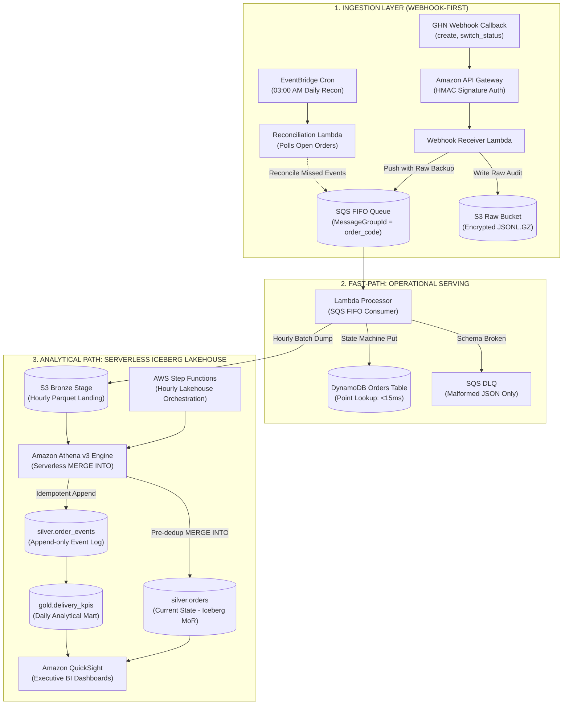

# KẾ HOẠCH ĐỀ ÁN KỸ THUẬT (TECHNICAL PROJECT PROPOSAL)
## XÂY DỰNG NỀN TẢNG ENTERPRISE DATA LAKEHOUSE CHO GHN LOGISTICS
**Người đề xuất đề án:** Nguyễn Đình Tấn Lộc (Data Engineering Team)  
**Vai trò hệ thống:** Nền tảng Dữ liệu Chuỗi cung ứng phía Doanh nghiệp / Đối tác tích hợp (Merchant Data Platform)  
**Tình trạng:** Sẵn sàng phê duyệt & Triển khai (Approved Architecture)  

---

## 1. TỔNG QUAN & BỐI CẢNH DỰ ÁN (PROJECT OVERVIEW & CONTEXT)

### 1.1. Bối cảnh nghiệp vụ & Phân định vai trò hệ thống
Hệ thống đóng vai trò là **Nền tảng dữ liệu Logistics của Doanh nghiệp (Merchant / E-commerce Integrator)** kết nối với dịch vụ vận chuyển Giao Hàng Nhanh (GHN). Trong mô hình vận hành thực tế:
* **Phương thức thu thập chính: Webhook-First (Event-Driven):**
  * GHN cung cấp hệ thống Webhook chính thức trên Developer Portal với các callback sự kiện: `create`, `switch_status`, `update_weight`. Các sự kiện được GHN gửi theo cơ chế **FIFO cho từng mã đơn hàng**, phản ánh đúng trình tự nghiệp vụ phát sinh với độ trễ tính bằng giây.
  * Việc sử dụng Webhook loại bỏ hoàn toàn bài toán quá tải của Polling: Nếu dùng Polling cho 30,000 đơn/ngày (với 60,000–90,000 đơn đang mở), hệ thống sẽ phải gọi 17–26 triệu lượt API/ngày (~200–300 calls/giây), gây lãng phí hàng ngàn USD và dễ bị khóa rate-limit.
* **Vai trò của Polling: Đối soát bù giờ (Reconciliation Only):**
  * Polling định kỳ qua endpoint `POST /shipping-order/detail` chỉ đóng vai trò là job phụ chạy 1 lần/ngày vào ban đêm (03:00 AM) để rà soát các đơn chưa hoàn tất, bù đắp các webhook bị thất thoát do sự cố mạng.
* **Khai thác mảng `log` lịch sử của GHN:**
  * Chi tiết vận đơn trả về từ GHN chứa mảng `log` ghi nhận toàn bộ các bước chuyển trạng thái trong quá khứ kèm mốc thời gian (`updated_date`). Khai thác mảng `log` này giúp hệ thống **bảo toàn 100% các sự kiện trung gian**, không bao giờ bị mất dấu dù mạng có bị gián đoạn tạm thời.

### 1.2. Biện minh kiến trúc & Lựa chọn công nghệ Lakehouse
* **Tại sao cần Apache Iceberg ở quy mô 30,000 đơn/ngày (~1 triệu bản ghi/tháng)?**
  * *Bản chất Mutable của dữ liệu:* Đơn hàng logistics thay đổi trạng thái 5–7 lần trong vòng đời. Dùng Parquet thuần trên S3 buộc phải ghi đè phân vùng liên tục (tốn I/O, dễ race condition) hoặc gây trùng lặp dữ liệu lớn làm chậm truy vấn. Iceberg cung cấp cơ chế **Row-level Upsert / Merge** giải quyết dứt điểm bài toán này.
  * *Quản trị Metadata & Loại bỏ Small Files:* Iceberg tự động quản lý metadata tệp và hỗ trợ nén gộp (Compaction/OPTIMIZE) chuẩn hóa.
  * *Khả năng mở rộng 100x:* Giúp hệ thống sẵn sàng mở rộng lên hàng triệu đơn/ngày mà không phải thay đổi kiến trúc lưu trữ.
* **Lựa chọn Amazon Athena v3 Serverless MERGE thay vì cụm Spark Glue:**
  * Ở quy mô ~1,250 đơn/giờ, việc duy trì hoặc khởi động cụm AWS Glue PySpark (2 DPU, tối thiểu 2–3 phút khởi động container) mỗi giờ sẽ gây lãng phí lớn (\$30–\$60/tháng).
  * **Amazon Athena v3** hỗ trợ câu lệnh `MERGE INTO` native trên Apache Iceberg theo mô hình hoàn toàn Serverless. Chạy lệnh Athena MERGE mỗi giờ chỉ tốn vài chục megabytes scan $\to$ Chi phí chỉ **<\$2.00 / tháng**, tiết kiệm hơn 90% chi phí điện toán mà vẫn giữ trọn vẹn sức mạnh của Apache Iceberg.

---

## 2. THIẾT KẾ KIẾN TRÚC HAI LUỒNG (DUAL-PATH ARCHITECTURE)

Hệ thống phân tách rạch ròi giữa luồng phục vụ thời gian thực và luồng phân tích chuyên sâu:



### 2.1. Phân định rõ SLA Độ tươi dữ liệu vs Độ trễ truy vấn
* **Operational Serving (Fast-Path qua Webhook & DynamoDB):**
  * *Độ trễ truy vấn (Read Latency):* $< 15\text{ms}$ khi tra cứu qua khóa chính `pk=ORDER#{code}`, `sk={date}` trên DynamoDB.
  * *Độ tươi dữ liệu (Data Freshness SLA):* **$< 5$ giây** từ khi bưu tá cập nhật trên ứng dụng GHN đến khi hiển thị trên hệ thống CSKH (nhờ kiến trúc Webhook Push trực tiếp vào SQS FIFO).
* **Analytical Lakehouse (Athena Serverless Path):**
  * *Tần suất cập nhật (Cadence):* Cập nhật theo giờ (Hourly Batch) hoặc cuối ngày (Daily).
  * *Độ tươi dữ liệu phân tích:* $\le 60$ phút, hoàn toàn đáp ứng các báo cáo vận hành, quản trị KPI và đối soát kế toán.

---

## 3. THIẾT KẾ XỬ LÝ LỖI HỆ THỐNG PHÂN TÁN (CORE DE-RISKING DESIGNS)

### 3.1. Đồ thị trạng thái phân tầng 2 cấp & Công thức `delivery_attempt`
Để giải quyết triệt để lỗi của thang rank tuyến tính và xử lý chính xác vòng lặp giao lại:

```
[ CẤP 1: PRIMARY PHASES ]
  Phase 1: PICKUP (ready_to_pick, picking, picked)
     │
     ▼
  Phase 2: TRANSIT (storing, sorting, transporting)
     │
     ▼
  Phase 3: DELIVERY ATTEMPT LOOP (delivering ──► delivery_fail ──► returning)
     │                                ▲             │
     │                                └─────────────┘ (Retry attempt + 1)
     ▼
  Phase 4: TERMINAL SINK (delivered, returned, cancelled, lost, damage, scrap, exception)
```

#### Quy tắc chuyển đổi trạng thái (Transition Rules):
1. **Nút lá kết thúc (Terminal Sink Nodes):** `delivered`, `returned`, `cancelled`, `lost`, `damage`, `scrap`, `exception`. Một khi đơn hàng đạt Terminal State, **tuyệt đối không cho phép bất kỳ trạng thái nào ghi đè lên**.
2. **Xác định lượt giao (`delivery_attempt`):**
   * Được tính chuẩn xác từ mảng `log` lịch sử:
     $$\text{delivery\_attempt} = 1 + \text{Số lần xuất hiện trạng thái } delivery\_fail \text{ TRƯỚC thời điểm của sự kiện này}$$
   * Ví dụ: Khi bưu tá đi phát lần 1, số lần fail trước đó = 0 $\to$ `attempt = 1`. Khi giao thất bại lần 1, số lần fail trước đó = 0 $\to$ `delivery_fail` mang `attempt = 1`. Khi bưu tá đi phát lần 2, số lần fail trước đó = 1 $\to$ `delivering` mang `attempt = 2`.
3. **Quy tắc so khớp nội bộ trong lượt giao (Intra-phase Rules):**
   * Khi cùng `delivery_attempt = k`: Trạng thái `delivering` **không bao giờ được ghi đè** lên `delivery_fail` hay `delivered` (chống lệch đồng hồ bưu tá).
   * Khi giao lại (`delivery_attempt = k + 1`): Bản ghi `delivering` của lượt giao mới có `attempt` cao hơn nên được cập nhật hợp lệ (giải quyết dứt điểm ca giao lại lần 2).
4. **Ứng xử với bản ghi Stale & Trạng thái lạ:**
   * Bản ghi stale chỉ được ghi nhận vào `silver.order_events` để phục vụ audit mạng; **No-op trên bảng `silver.orders` và DynamoDB**.
   * Các trạng thái chưa có trong từ điển chuẩn hóa được gán nhãn `unknown_state` và đưa vào bảng giám sát ngoại lệ, **tuyệt đối không làm gãy pipeline và không gửi vào DLQ**.

### 3.2. Cơ chế Pre-deduplication & Hợp nhất Dữ liệu (Athena Serverless MERGE)
Để triệt tiêu hoàn toàn lỗi Cardinality Violation ("multiple source rows matched") và ngăn chặn nhân bản số dòng trong `order_events`:

1. **Ghi Idempotent vào bảng nhật ký `silver.order_events`:**
   * Mỗi sự kiện được gán khóa định danh xác định: `event_id = sha256(order_code || status || updated_at)`.
   * Lọc trùng lặp trên tập nguồn (Source Pre-dedup) theo `event_id` trước khi chạy MERGE.
   * Áp dụng kỹ thuật **Partition Pruning** theo ngày tạo đơn (`created_date`) để chỉ quét đúng phân vùng liên quan, tối ưu hóa tốc độ và chi phí truy vấn.

2. **Pre-deduplication & Upsert vào bảng trạng thái hiện hành `silver.orders`:**
   * Áp dụng Window Function (`ROW_NUMBER()`) trên dữ liệu Bronze để chọn ra bản ghi duy nhất có độ ưu tiên cao nhất cho mỗi đơn hàng trong batch, dựa trên hàm so khớp đồng nhất:
     $$\text{is\_terminal} \succ \text{delivery\_attempt} \succ \text{phase\_rank} \succ \text{updated\_at}$$
   * Thực thi câu lệnh `MERGE INTO` có điều kiện: Chỉ cho phép ghi đè khi đơn hàng đích chưa đạt trạng thái kết thúc (Terminal) và bản ghi nguồn có mức độ tiến triển nghiệp vụ hợp lệ.

*(Ghi chú: Toàn bộ mã nguồn truy vấn SQL Athena DML chi tiết được trình bày tại **Phụ lục Kỹ thuật A** ở cuối tài liệu).*

### 3.3. Điều phối tuần tự qua AWS Step Functions & Lịch bảo trì (VACUUM)
Để loại bỏ 100% nguy cơ xung đột commit (OCC conflict):
* **AWS Step Functions Orchestrator:** Điều phối chuỗi công việc theo tuần tự nghiêm ngặt:
  $$\text{1. Execute MERGE events} \longrightarrow \text{2. Execute MERGE orders} \longrightarrow \text{3. Run Daily Gold Aggregation}$$
* **Lịch trình nén tệp (OPTIMIZE) và dọn dẹp Snapshot (VACUUM):**
  * Tách rời hoàn toàn khỏi luồng MERGE: Đặt lịch chạy vào **02:00 AM ban đêm** (khi không có batch MERGE nào chạy) để gộp các tệp Parquet phân mảnh (Bin-pack Compaction) và dọn dẹp các snapshot hết hạn.

---

## 4. BẢO MẬT & TUÂN THỦ LUẬT BẢO VỆ DỮ LIỆU CÁ NHÂN SỐ 91/2025/QH15

### 4.1. Căn cứ pháp lý bưu chính (Luật 91/2025/QH15 & Nghị định 356/2025/NĐ-CP)
* Dữ liệu vận đơn là **chứng từ hợp đồng dịch vụ vận tải và chứng từ hạch toán thuế**, thuộc nhóm **Nghĩa vụ pháp lý lưu trữ bắt buộc (Legal Obligation)** từ 1 đến 5 năm theo quy định của Luật Kế toán và Luật Bưu chính Việt Nam.
* Quyền yêu cầu xóa dữ liệu (Right to be Forgotten) của chủ thể dữ liệu cá nhân chỉ áp dụng cho dữ liệu marketing hoặc hồ sơ tài khoản, **không được phép xóa làm sai lệch chứng từ kế toán và vận đơn đang trong thời hạn lưu trữ bắt buộc**.

### 4.2. Rào chắn bảo mật & Che mờ dữ liệu (Masking View)
1. **Mã hóa dữ liệu tại chỗ (At-Rest):** Toàn bộ S3 Buckets, DynamoDB Tables và SQS Queues được mã hóa bằng **AWS KMS Customer Managed Key (CMK)** với chính sách Key Rotation tự động hàng năm.
2. **Che mờ PII qua Athena SQL View:**
   * Vì AWS Lake Formation chỉ hỗ trợ lọc cột (Column Filtering) chứ không tự sinh chuỗi masking, hệ thống tạo View phân quyền chuyên dụng (`orders_masked`) cho nhóm phân tích BI: Tự động che mờ số điện thoại (`090*****89`) và họ tên (`N***`), cô lập hoàn toàn PII dạng rõ.
3. **Quy trình xử lý yêu cầu xóa PII hợp lệ:**
   * Khi hết thời hạn khiếu nại hoặc nhận được yêu cầu xử lý PII hợp lệ:
   * **Trên tầng Serving (DynamoDB):** Cập nhật `to_phone = 'REDACTED'`, `to_name = 'REDACTED'`, `to_address = 'REDACTED'`.
   * **Trên tầng Lakehouse (Apache Iceberg):** Thực thi lệnh Row-level Update trực tiếp trên bảng `silver.orders` để ẩn thông tin cá nhân.
   * **Trên tầng S3 Raw:** Dữ liệu tự động hủy sạch sẽ theo **S3 Lifecycle Expiry** (30 ngày trên S3 Standard, tự hủy sau 1 năm trên Glacier Archive).

*(Ghi chú: Chi tiết cú pháp SQL Masking View và Redaction được trình bày tại **Phụ lục Kỹ thuật B**).*

---

## 5. ĐỊNH NGHĨA TẦNG GOLD & CÔNG THỨC KPI VẬN HÀNH LOGISTICS

Tầng Gold (`gold.delivery_kpis`) tổng hợp số liệu theo ngày tạo đơn (`created_date`) và tuyến vận chuyển (`from_province` $\to$ `to_province`):

| Tên chỉ số (KPI Metric) | Ý nghĩa nghiệp vụ | Công thức tính toán chuẩn xác (SQL Logic) |
|---|---|---|
| **First-Attempt Delivery Rate (FADR)** | Tỷ lệ đơn giao thành công ngay ở lượt giao đầu tiên. | $\frac{\text{COUNT(DISTINCT order\_code WITH delivered AND attempt=1)}}{\text{COUNT(DISTINCT order\_code ĐÃ HOÀN TẤT LƯỢT GIAO 1 (delivered=1 OR fail=1))}} \times 100\%$ |
| **Return Rate (Tỷ lệ hoàn)** | Tỷ lệ đơn phải chuyển hoàn về shop người gửi. | $\frac{\text{COUNT(DISTINCT order\_code WITH status='returned')}}{\text{COUNT(DISTINCT order\_code ĐÃ KẾT THÚC (Mature Cohort: delivered + returned + cancel))}} \times 100\%$ |
| **On-Time Delivery Rate (OTDR)** | Tỷ lệ giao hàng đúng hạn cam kết SLA. | $\frac{\text{COUNT(DISTINCT order\_code WITH delivered\_at} \le \text{sla\_committed\_at)}}{\text{COUNT(DISTINCT order\_code WITH delivered)}} \times 100\%$ |
| **Pick-to-Delivery Lead-Time** | Thời gian trung bình từ khi lấy hàng đến khi phát thành công. | $\text{AVG}(\text{delivered\_at} - \text{picked\_at}) \text{ tính theo giờ (Loại bỏ các bản ghi NULL)}$ |

*(Ghi chú: Return Rate được tính toán trên Cohort các đơn hàng tạo từ 7–10 ngày trước để đảm bảo đơn hàng đã đủ thời gian đi hết vòng đời).*

---

## 6. MÔI TRƯỜNG KIỂM THỬ CỤC BỘ DOCKER (LOCAL PRE-FLIGHT TEST HARNESS)

### 6.1. Đồng nhất môi trường kiểm thử (Trino + Iceberg)
Để tránh hiện tượng lệch engine giữa local và production (trước đây chạy Spark local nhưng production chạy Athena Trino):
* **Cụm Docker Local:** 
  * **Trino Container:** Chạy đúng engine Presto/Trino mà Amazon Athena v3 sử dụng, kết nối MinIO và Iceberg REST Catalog.
  * **LocalStack Community:** Giả lập S3, DynamoDB, SQS FIFO.
  * **MinIO Object Storage:** Lưu trữ tệp Parquet và Iceberg Metadata v2.

### 6.2. Ma trận kiểm thử mở rộng (Chaos & Failure Test Matrix)
| Mã test | Tình huống thử nghiệm | Hành vi kỳ vọng của hệ thống |
|---|---|---|
| **TC-01** | *Webhook FIFO Sequencing* | Bắn 3 webhook liên tiếp cho 1 đơn hàng qua SQS FIFO $\to$ Đơn hàng được xử lý đúng tuần tự tuyệt đối. |
| **TC-02** | *Giao lại lần 2 (Retry Loop)* | Bơm: `delivering (attempt 1)` $\to$ `delivery_fail` $\to$ `delivering (attempt 2)` $\to$ `delivered`. Bảng `orders` ghi nhận `delivered (attempt 2)`. |
| **TC-03** | *Chống Out-of-Order Stale* | Bơm `delivered` lúc 11:00, sau đó bơm `delivering` (lần 1) lúc 11:05. Trạng thái `delivered` tuyệt đối không bị ghi đè. |
| **TC-04** | *Idempotent Event Log* | Chạy lặp lại batch với cùng `event_id` $\to$ Bảng `order_events` không bị nhân đôi số dòng nhờ cơ chế dedup. |
| **TC-05** | *Explode Mảng Log Lịch Sử* | Nhận payload có mảng `log` gồm 5 bước $\to$ Hệ thống tự động bung đủ 5 dòng vào `order_events`. |
| **TC-06** | *Athena SQL Engine Parity* | Chạy script SQL `MERGE INTO` trực tiếp trên Trino container $\to$ Thành công 100% cú pháp, không có lỗi runtime. |

---

## 7. DỰ TOÁN TÀI NGUYÊN & BẢNG CHI PHÍ AWS THỰC TẾ (COST ESTIMATION)

Bảng phân bổ chi phí chuẩn xác, phản ánh đúng kiến trúc Webhook-First và Athena Serverless (đã loại bỏ Kinesis Firehose thừa):

| Dịch vụ AWS | Quy cách cấu hình & Tải tính toán | Chi phí/tháng |
|---|---|---|
| **API Gateway & Lambda** | Webhook Receiver (100k requests/tháng) + Processor | ~\$1.20 |
| **Amazon SQS FIFO** | Hàng đợi đệm đảm bảo thứ tự cho từng đơn hàng | ~\$0.40 |
| **Amazon S3** | 10 GB Raw (Glacier lifecycle) + 20 GB Silver Iceberg + Metadata | ~\$1.20 |
| **Amazon DynamoDB** | On-demand (~1 triệu write + 2 triệu read/tháng) | ~\$2.50 |
| **Amazon Athena v3 (Serverless)** | Chạy `MERGE INTO` mỗi giờ (24 lần/ngày $\times$ 50MB scan) + BI queries | **~\$1.50** |
| **Amazon QuickSight** | **1 Author License (\$24) + Reader Sessions (\$5)** | **~\$29.00** |
| **KMS, CloudWatch, Secrets Mgr** | Quản lý khóa KMS, Logs retention 14 ngày, Budget Alerts | ~\$4.50 |
| **Tổng ngân sách thực tế** | **Toàn bộ nền tảng End-to-End đầy đủ Dashboard BI** | **~\$39.80 – \$40.50 / tháng** |

*(Ngân sách hoàn toàn nằm trong khoản credit \$200 cho 3 tháng thử nghiệm).*

---

## 8. QUẢN TRỊ RỦI RO & RỦI RO CÒN LẠI (RESIDUAL RISKS & LIMITATIONS)

| Rủi ro kỹ thuật | Mức độ | Hậu quả tiềm ẩn | Biện pháp giảm thiểu |
|---|---|---|---|
| **Mất kết nối Webhook từ GHN** | Trung bình | Webhook bị gián đoạn do sự cố mạng giữa GHN và API Gateway. | **Reconciliation Polling Job**: Chạy tự động lúc 03:00 AM hàng ngày để quét các đơn mở, bù đắp 100% các sự kiện bị rớt. |
| **Xung đột Commit (Iceberg OCC Conflict)** | Thấp | Xảy ra nếu job `OPTIMIZE` và câu lệnh `MERGE` chạy trùng thời điểm. | **AWS Step Functions**: Điều phối chạy `OPTIMIZE` vào 02:00 AM, tách biệt hoàn toàn khỏi các khung giờ chạy batch `MERGE`. |
| **GHN API bổ sung mã trạng thái mới** | Trung bình | Xuất hiện các mã nghiệp vụ mới chưa có trong từ điển chuẩn hóa. | Thiết kế chính sách `unknown_state`: Tự động gán nhãn và chuyển hướng vào bảng giám sát ngoại lệ, không làm sập pipeline. |

---

## 9. KẾ HOẠCH TRIỂN KHAI PHÂN KỲ (4-WEEK REALISTIC ROADMAP)

* **Tuần 1: Local Test Harness & Sửa Logic Cốt Lõi (Fast-Path)**
  * Dựng `docker-compose.local.yml` với Trino Container + Iceberg + LocalStack.
  * Cài đặt State Machine 2 cấp trong `OrderWriter` và triển khai Webhook Receiver qua SQS FIFO.
* **Tuần 2: Thiết lập Iceberg Dual-Table & Athena Serverless MERGE**
  * Khai báo bảng Iceberg `orders` và `order_events` trong AWS Glue Data Catalog bằng CDK.
  * Viết và kiểm thử script SQL `MERGE INTO` Serverless trên Trino/Athena.
* **Tuần 3: Quản trị Dữ liệu, Masking View & Bộ Kiểm Thử Chaos**
  * Thiết lập mã hóa KMS CMK và cấu hình SQL Masking View tuân thủ Luật 91/2025/QH15.
  * Thực thi trọn vẹn 6 kịch bản thử nghiệm (TC-01 đến TC-06) trên môi trường Docker.
* **Tuần 4: Triển khai Staging AWS Thật & QuickSight BI**
  * Triển khai toàn bộ hạ tầng lên AWS bằng AWS CDK.
  * Tích hợp Athena v3 và dựng Dashboard trực quan hóa KPI trên Amazon QuickSight.
  * Đóng gói tài liệu vận hành (Runbook) và nghiệm thu dự án.

---

## 10. PHỤ LỤC KỸ THUẬT (TECHNICAL APPENDIX)

### Phụ lục A: Đặc tả câu lệnh Athena Iceberg DML (Trino Engine Syntax)

#### A.1. Ghi Idempotent vào bảng nhật ký `silver.order_events`:
```sql
MERGE INTO ghn_analytics.order_events AS target
USING (
  SELECT 
    order_code,
    status,
    updated_at,
    created_date,
    to_hex(sha256(to_utf8(concat(order_code, '||', status, '||', to_iso8601(updated_at))))) AS event_id,
    ROW_NUMBER() OVER (
      PARTITION BY order_code, status, updated_at 
      ORDER BY updated_at DESC
    ) AS rn
  FROM bronze_staging
) AS source
ON target.created_date = source.created_date 
   AND target.event_id = source.event_id
WHEN NOT MATCHED AND source.rn = 1 THEN
  INSERT (
    order_code, 
    status, 
    updated_at, 
    created_date, 
    event_id, 
    ingested_at
  )
  VALUES (
    source.order_code, 
    source.status, 
    source.updated_at, 
    source.created_date, 
    source.event_id, 
    current_timestamp
  );
```

#### A.2. Pre-deduplication & Upsert vào bảng trạng thái hiện hành `silver.orders`:
```sql
MERGE INTO ghn_analytics.orders AS target
USING (
  SELECT 
    order_code,
    client_order_code,
    status,
    is_terminal,
    delivery_attempt,
    phase_rank,
    created_at,
    created_date,
    updated_at,
    delivered_at,
    weight,
    shipping_fee,
    cod_amount,
    lead_time_hours
  FROM (
    SELECT *,
      ROW_NUMBER() OVER (
        PARTITION BY order_code 
        ORDER BY 
          is_terminal DESC, 
          delivery_attempt DESC, 
          phase_rank DESC, 
          updated_at DESC
      ) AS rn
    FROM bronze_staging
  )
  WHERE rn = 1
) AS source
ON target.created_date = source.created_date 
   AND target.order_code = source.order_code
WHEN MATCHED AND (
  target.is_terminal = false AND (
    source.is_terminal = true OR
    source.delivery_attempt > target.delivery_attempt OR
    (source.delivery_attempt = target.delivery_attempt AND (
      source.phase_rank > target.phase_rank OR
      (source.phase_rank = target.phase_rank AND source.updated_at > target.updated_at)
    ))
  )
) THEN
  UPDATE SET 
    status = source.status,
    is_terminal = source.is_terminal,
    delivery_attempt = source.delivery_attempt,
    phase_rank = source.phase_rank,
    updated_at = source.updated_at,
    delivered_at = source.delivered_at,
    weight = source.weight,
    shipping_fee = source.shipping_fee,
    cod_amount = source.cod_amount,
    lead_time_hours = source.lead_time_hours,
    ingested_at = current_timestamp
WHEN NOT MATCHED THEN
  INSERT (
    order_code, client_order_code, status, is_terminal, 
    delivery_attempt, phase_rank, created_at, created_date, 
    updated_at, delivered_at, weight, shipping_fee, 
    cod_amount, lead_time_hours, ingested_at
  )
  VALUES (
    source.order_code, source.client_order_code, source.status, source.is_terminal, 
    source.delivery_attempt, source.phase_rank, source.created_at, source.created_date, 
    source.updated_at, source.delivered_at, source.weight, source.shipping_fee, 
    source.cod_amount, source.lead_time_hours, current_timestamp
  );
```

#### A.3. Lệnh bảo trì Compaction & Dọn dẹp Snapshot (Chạy lúc 02:00 AM):
```sql
OPTIMIZE ghn_analytics.orders REWRITE DATA USING BIN_PACK;
VACUUM ghn_analytics.orders;
```

---

### Phụ lục B: Cú pháp Data Masking View & Redaction PII

#### B.1. DDL tạo Masking View cho Business Intelligence:
```sql
CREATE OR REPLACE VIEW ghn_analytics.orders_masked AS
SELECT 
  order_code,
  status,
  created_at,
  delivered_at,
  shipping_fee,
  cod_amount,
  lead_time_hours,
  CASE
    WHEN to_phone IS NULL OR to_phone = 'REDACTED' THEN to_phone
    ELSE CONCAT(SUBSTR(to_phone, 1, 3), '*****', SUBSTR(to_phone, 9, 2))
  END AS to_phone_masked,
  CASE
    WHEN to_name IS NULL OR to_name = 'REDACTED' THEN to_name
    ELSE CONCAT(SUBSTR(to_name, 1, 1), '***')
  END AS to_name_masked,
  to_province_id,
  to_district_id
FROM ghn_analytics.orders;
```

#### B.2. DML thực thi quyền được xóa dữ liệu cá nhân (Right to be Forgotten):
```sql
UPDATE ghn_analytics.orders 
SET 
  to_name = 'REDACTED', 
  to_phone = 'REDACTED', 
  to_address = 'REDACTED'
WHERE order_code = 'GHN123456';
```
