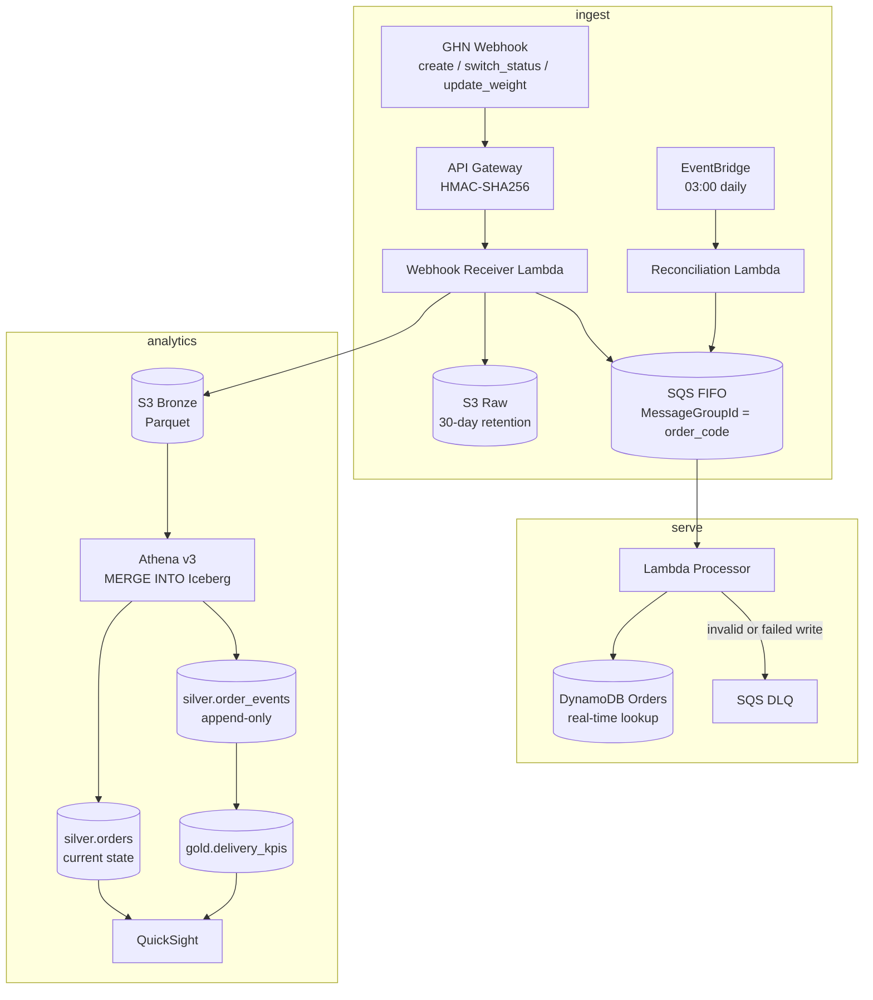

# Architecture

Kiến trúc đích theo Proposal v5.0 (ADR 004 + ADR 005): **webhook-first, SQS FIFO,
Athena v3 serverless trên Iceberg**. Mỗi tầng có đúng một nguồn sự thật, và mỗi
record có đường đi rõ ràng kể cả khi thất bại.

## Data flow



## Layers and their source of truth

| Layer | Store | Source of truth for | Retention |
|---|---|---|---|
| Raw | S3 `raw/` | Sao lưu mọi payload webhook và response API. Nothing is lost here. | 30 days |
| Bronze | S3 `bronze/` | Input cho lớp phân tích; nơi Athena merge đọc | 90 days |
| Silver | Iceberg `order_events` / `orders` | Lịch sử sự kiện (append-only) + trạng thái hiện hành | Unlimited |
| Gold | Iceberg `delivery_kpis` | KPI vận hành theo ngày, theo tuyến | Unlimited |
| Real-time | DynamoDB | Point lookup cho một đơn (serving) | Unlimited |
| Failed | SQS DLQ | Mọi record thất bại, chờ replay | 14 days |

Quy tắc cốt lõi: **a record is never dropped**. Không validate được, hoặc ghi
thất bại, record vào DLQ kèm lý do; `scripts/replay_dlq.py` đưa nó trở lại.

## Component responsibilities

| Component | Responsibility | Explicitly not its job |
|---|---|---|
| API Gateway | Nhận webhook, expose HTTPS endpoint | Không xử lý nghiệp vụ |
| Webhook Receiver | Verify HMAC, ghi S3 raw, push SQS FIFO (dedup ID), dump bronze | Không transform, không aggregate |
| Reconciliation Lambda | 03:00 hằng ngày, poll watchlist đối soát, bù event bị rớt | Không tạo order mới |
| SQS FIFO | Giữ thứ tự sự kiện theo `order_code`, dedup 5 phút | Không lưu dài hạn |
| Lambda Processor | Validate, transform, dedupe, write DynamoDB | Không aggregate |
| Athena MERGE | Ghi idempotent vào `order_events`, upsert có điều kiện vào `orders` | Không server dashboard |
| QuickSight | BI cho business | Không tính metric |

## State machine (Two-Level)

Thứ tự ưu tiên khi nhiều event cùng batch (áp dụng giống hệt ở DynamoDB và
Iceberg merge):

```
is_terminal > delivery_attempt > phase_rank > updated_at
```

- Trạng thái kết thúc (7 terminal states) là bất biến: event cũ đến muộn không
  ghi đè.
- `delivery_attempt = 1 + số lần `delivery_fail` trước đó trong mảng `log``.
- Cùng lượt giao so `phase_rank`; lượt giao mới (attempt cao hơn) ghi đè hợp lệ.
- Chi tiết ở `docs/PROPOSAL.md` mục 5.2 và `src/lambda/processor/ddb_writer.py`.

## Cost model (target architecture)

| Service | Monthly estimate | Note |
|---|---|---|
| API Gateway + Lambda | $1.20 | Receiver ~100k request/tháng + Processor + Reconciliation |
| SQS FIFO | $0.40 | Buffer, dedup theo order_code |
| S3 | $1.20 | 10 GB raw (Glacier lifecycle) + 20 GB silver/metadata |
| DynamoDB | $2.50 | On-demand, ~1M write + 2M read/tháng |
| Athena v3 | $1.50 | MERGE mỗi giờ, ~50 MB scan/lần + BI queries |
| QuickSight | $29.00 | 1 Author + Reader sessions |
| KMS / CloudWatch / Secrets | $4.50 | Rotation, log 14 ngày, budget alerts |
| **Total** | **~$40** | Trong $200 credit cho 3 tháng |

Không có NAT gateway (lambda gọi API công khai), không Kinesis Firehose,
không Glue Spark chạy định kỳ — đây là khác biệt chính so với bản kiến trúc
cũ và là lý do chi phí giảm từ ~$55–65 xuống ~$40.

## Stack dependencies

```
base
├── ingestion     (API Gateway, Webhook Receiver, SQS FIFO, Reconciliation, Secrets)
├── processing    (Lambda Processor, DynamoDB, SQS DLQ)
├── analytics     (Glue Data Catalog, Athena workgroup, Step Functions MERGE/OPTIMIZE)
└── monitoring    (CloudWatch, SNS, Budgets)
```

`base` giữ KMS keys, S3 buckets, DynamoDB tables, log retention — mỗi thứ chỉ
được định nghĩa một lần; các stack khác reference.

## Legacy (vẫn còn trong repo, chưa gỡ)

Phần hạ tầng thuộc kiến trúc cũ (polling + Kinesis Firehose + Glue PySpark):

- `cdk/stacks/streaming_stack.py` (Kinesis Data Streams + Firehose)
- `cdk/stacks/analytics_stack.py` (2 Glue ETL job PySpark, Step Functions chạy Glue)
- `src/glue/jobs/bronze_to_silver.py`, `silver_to_gold.py`
- EventBridge 5-minute polling trong `ingestion_stack.py`

Chưa có trong repo (mục ở `docs/PROPOSAL.md` mục 12):

- API Gateway + Webhook Receiver chưa được wire vào `IngestionStack`
- Reconciliation job, fencing lease, batch hash
- Stack Athena Iceberg thay thế Glue ETL
- QuickSight dashboard (thư mục `quicksight/` còn rỗng)

Chiến lược gỡ legacy: deploy xong đường đích, chạy song song 1 cycle, xác
minh số dòng `orders` khớp, rồi tắt Firehose + Glue ETL.

## Decisions

See `docs/adr/`:

- [ADR 001: CDK with Python](adr/001-cdk-python.md)
- [ADR 002: DynamoDB partition key design](adr/002-dynamodb-partition-key.md)
- [ADR 003: Athena over Redshift](adr/003-atena-over-redshift.md)
- [ADR 004: Webhook-first over polling](adr/004-webhook-first-over-polling.md)
- [ADR 005: Athena serverless Iceberg over Spark/Glue](adr/005-athena-serverless-iceberg-over-spark-glue.md)
- [ADR 006: Data privacy & retention under Law 91/2025](adr/006-data-privacy-retention-under-law-91-2025.md)
