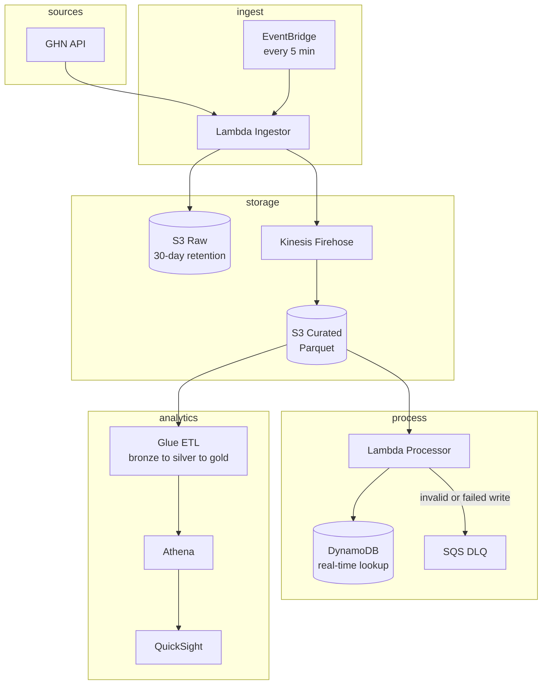

# Architecture

## Data flow



## Layers and their source of truth

| Layer | Store | Source of truth for | Retention |
|---|---|---|---|
| Raw | S3 `raw/` | Nothing is lost here. Durable backup of every API response. | 30 days |
| Curated | S3 `curated/` | The analytics source of truth. Parquet, partitioned. | 90 days |
| Real-time | DynamoDB | Point lookups for a single order. | Unlimited |
| Failed | SQS DLQ | Everything that failed, pending review and replay. | 14 days |

The rule that drives the design: **a record is never dropped**. If it cannot
be validated or written, it goes to the DLQ with the reason attached, and
`scripts/replay_dlq.py` can put it back.

## Why the raw bucket exists

The Ingestor writes to S3 raw *before* anything else. If the Processor
crashes, or Firehose is throttled, or a downstream schema change breaks
parsing, the original API response is still on disk and the pipeline can be
replayed from it. Without the raw layer, a transient failure means lost
data — which is exactly the failure mode the "durability" test case
(target: kill the Lambda mid-processing, data still recoverable) checks for.

## Component responsibilities

| Component | Responsibility | Explicitly not its job |
|---|---|---|
| EventBridge | Fire the ingest schedule | Not orchestrating data flow |
| Lambda Ingestor | Call GHN API, validate, write to S3 raw, push to Firehose | Not transforming, not writing to DynamoDB |
| Kinesis Firehose | Buffer, compress, write Parquet to S3 curated | Not transforming |
| Lambda Processor | Validate, transform, dedupe, write to DynamoDB | Not aggregating |
| Glue ETL | Bronze → silver → gold, apply business rules | Not real-time |
| Athena | Ad-hoc SQL over curated Parquet | Not serving the dashboard directly |
| QuickSight | Business-facing dashboards | Not computing metrics |

## Cost model

| Service | Monthly estimate | Note |
|---|---|---|
| Lambda | $0.15 | 288 ingest + 288 process invocations/day |
| Kinesis Firehose | $0.87 | Buffered writes |
| S3 | $0.23 | Under 1 GB/mo at current volume |
| DynamoDB | $3.00 | On-demand, real-time lookups |
| Glue | $26.40 | Crawler + 2 ETL jobs, daily schedule |
| Athena | $0.03 | Per query, 10 GB scan cutoff |
| QuickSight | $20.00 | 4 users |
| CloudWatch | $4.00 | Logs, metrics, dashboards |
| SNS | $0.05 | Alerts |
| **Total** | **~$55-65** | Within the $200 credit for ~3 months |

Glue is the largest line item. If the budget tightens, reduce the ETL
schedule from hourly to daily before touching anything else.

## Stack dependencies

```
base
├── ingestion      (Lambda, EventBridge, Secrets Manager)
├── streaming      (Kinesis, Firehose)
├── processing     (Lambda, DynamoDB, SQS)
├── analytics      (Glue, Athena)
└── monitoring     (CloudWatch, SNS, Budgets)
```

The `base` stack owns the VPC, the KMS keys, the S3 buckets, the DynamoDB
table and the log retention setting. Every other stack references those
resources rather than creating its own, so encryption and lifecycle policies
are defined exactly once.

## Decisions

See `docs/adr/`:

- [ADR 001: CDK with Python](adr/001-cdk-python.md)
- [ADR 002: DynamoDB partition key design](adr/002-dynamodb-partition-key.md)
- [ADR 003: Athena over Redshift](adr/003-atena-over-redshift.md)
